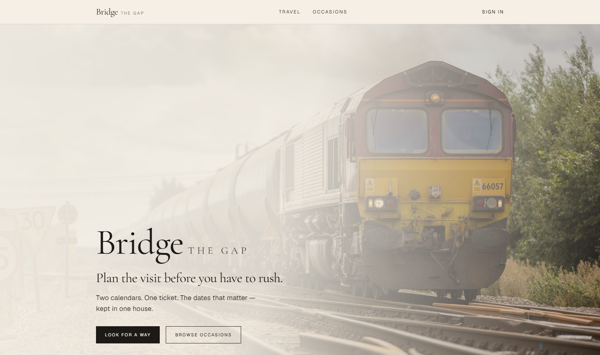
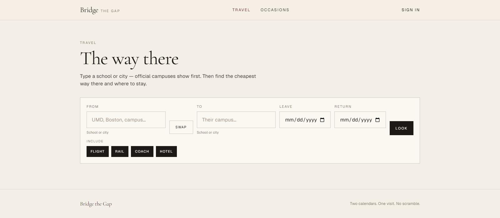
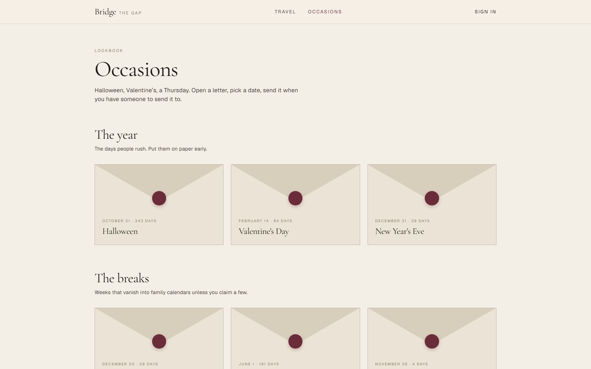
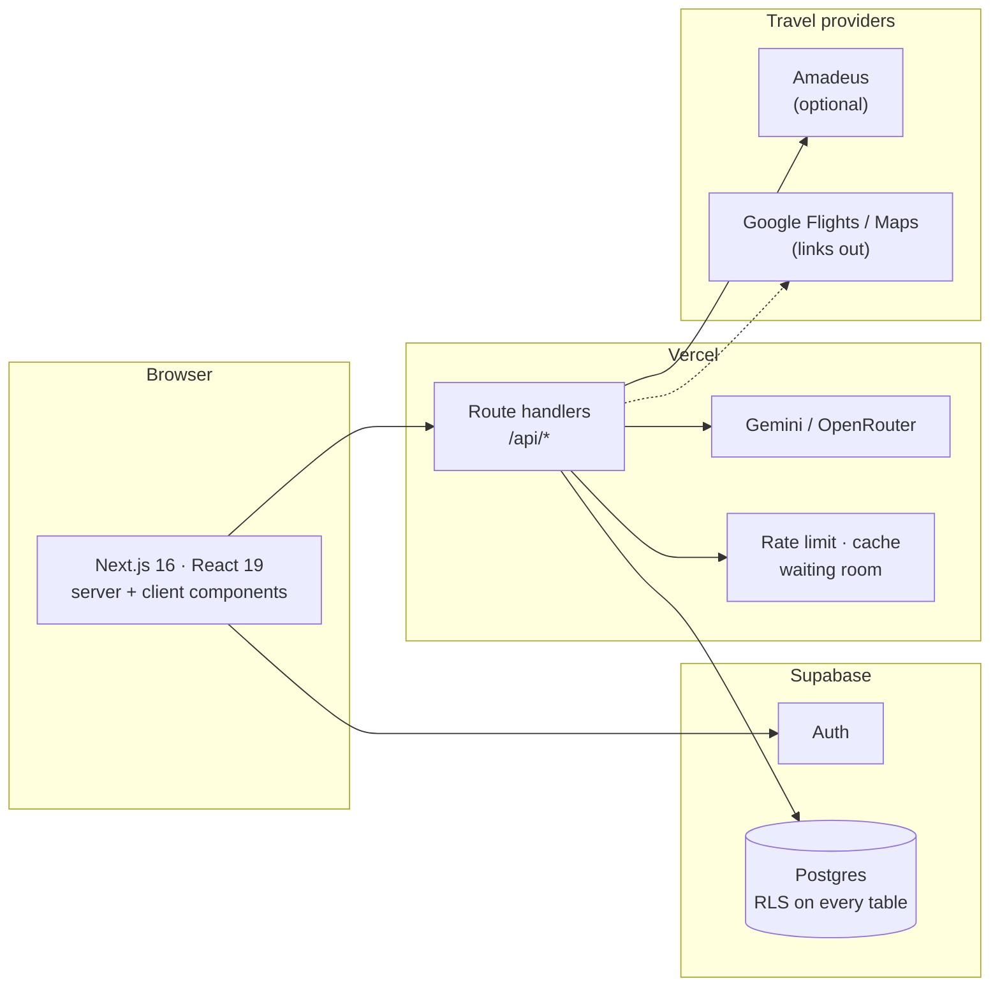

<h1 align="center">Bridge the Gap</h1>

<p align="center">
  <em>Two calendars. One visit. No scramble.</em>
</p>

<p align="center">
  <a href="https://bridge-the-gap-jade.vercel.app"><strong>Live app</strong></a> ·
  <a href="https://bridge-the-gap-jade.vercel.app/travel">Travel</a> ·
  <a href="https://bridge-the-gap-jade.vercel.app/occasions">Occasions</a> ·
  <a href="#architecture">Architecture</a> ·
  <a href="#getting-started">Getting started</a>
</p>

<p align="center">
  
  
  
  
  
  
</p>

<p align="center">
  
</p>

---

## What it is

A planning app for students in long-distance relationships. Two people at two
schools, one shared calendar, and the question that eats a term: **when can we
actually see each other?**

It answers that in three moves — find a way there, find a week that fits both
timetables, and keep the plans, the letters and the countdown in one place.

It is **not** a booking site. A fare opens on the provider and is marked
**live** or **estimate**; the app never pretends to sell you the ticket and
never holds a payment method.

## The rooms

| Room | What it answers |
| --- | --- |
| **Home** (`/home`) | Whose house, when the next visit is, how many days, and what still needs an answer. |
| **Together** (`/together`) | The two of you on one page: visits, the next date that matters, and the time between. |
| **Calendar** (`/calendar`) | One month, both lives. Dates, visits and the days that are already spoken for. |
| **Travel** (`/travel`) | From your campus to theirs. Flights, rail, coach and a place to stay, ranked — with live versus estimated fares labelled. |
| **Occasions** (`/occasions`) | A lookbook of the year: Halloween, Valentine's, winter break, a Thursday. Pick a date and send a letter. |
| **Letters** (`/letters`) | Notes written ahead of time and delivered on the day — waiting, sent, kept. |
| **Partner** (`/connect`) | A partner is a code, not a feed. Share a code, link one account, no public browsing. |
| **Account** (`/profile`) | A name, a city, a school. That is the whole social graph. |

Travel and Occasions work signed out. Everything else opens after sign-in, and
a new account starts empty — no demo partner, no seeded history.

## Screenshots

| Travel | Occasions |
| :---: | :---: |
|  |  |
| Campus-to-campus search with a swap button and mode toggles. | Envelope cards, counted down. Pick one and write. |

## Stack

| Layer | Choice | Why |
| --- | --- | --- |
| UI | **Next.js 16** (App Router), **React 19**, **Tailwind CSS 4** | Server components for the shell, client components only where a calendar or a form needs state. |
| API | **Next.js route handlers** (`frontend-web/app/api/*`) | Same deploy as the UI, no second service to keep warm. |
| Data | **Supabase** — Postgres, Auth, Row Level Security | Auth and authorisation sit next to the rows they protect. |
| Travel | **Amadeus** (live flights, optional), **Google Flights / Maps** deep links, own estimators | Works with no keys; earns "live" only when a provider actually answers. |
| AI | **Gemini** or **OpenRouter**, server-side only | Two jobs: parse a pasted timetable, estimate a trip cost. Both degrade to heuristics. |

## Architecture



Three rules keep it honest:

- **The browser never holds a service key.** `SUPABASE_SERVICE_ROLE_KEY` is read
  only inside route handlers; the client gets the anon key and RLS does the rest.
- **A fare is only "live" if a provider said so.** Everything else is an
  estimate, labelled as one.
- **No public profiles.** You find a partner by exchanging a code, not by
  searching a directory of students.

## Getting started

Prerequisites: **Node 20+** and a free [Supabase](https://supabase.com) project.
Travel and AI keys are optional — the app runs without them.

```bash
git clone https://github.com/developer-az/BridgeTheGap.git
cd BridgeTheGap
npm install                 # root script installs frontend-web and backend
```

### 1. Create the database

Open your Supabase project → **SQL Editor** → paste and run
`backend/database_schema.sql`. It creates the baseline tables, enables Row Level
Security, and adds the policies every read relies on.

> The committed schema covers `users`, `connections`, `schedules` and
> `travel_plans`. The live app also reads `invitations`, `visits` and
> `couple_dates`, which are not in that file yet — the route handlers in
> `frontend-web/app/api/` are the source of truth for those columns. If you are
> standing this up fresh, dump your deployed schema with
> `pg_dump --schema-only` and commit it; that is the open task, not a hidden
> step.

### 2. Fill in the environment

```bash
cd frontend-web
cp .env.example .env.local
```

Set the three Supabase values from **Project Settings → API**. Everything else
can stay blank; the features that need a key say so when you open them.

| Variable | Where | Needed for |
| --- | --- | --- |
| `NEXT_PUBLIC_SUPABASE_URL` | client + server | anything at all |
| `NEXT_PUBLIC_SUPABASE_ANON_KEY` | client | auth and reads under RLS |
| `SUPABASE_SERVICE_ROLE_KEY` | **server only** | invitations, partner linking, server writes |
| `NEXT_PUBLIC_APP_URL` | server | invite links and redirects (defaults to localhost) |
| `OPENROUTER_API_KEY` | server | parsing a pasted class schedule |
| `GEMINI_API_KEY` | server | AI fallback for the same, plus cost estimates |
| `AMADEUS_CLIENT_ID` / `AMADEUS_CLIENT_SECRET` | server | live flight offers |
| `GOOGLE_MAPS_API_KEY` | server | ground-travel directions |
| `COLLEGE_SCORECARD_API_KEY` | server | university autocomplete |

### 3. Run it

```bash
npm run dev                 # from the repo root: http://localhost:3000
```

Sign up, finish the profile (name, city, school), then either exchange a partner
code from **Partner** or explore **Travel** and **Occasions** signed out.

## API

All first-party traffic goes to `/api/*` on the same origin. Every handler that
touches another person's data checks the session first.

| Group | Routes | Purpose |
| --- | --- | --- |
| **Users** | `GET/POST /api/users/profile`, `GET /api/users/search`, `GET /api/users/[id]`, `/by-public-id/[publicId]` | Profile read/write, partner lookup by code's public id. |
| **Connections** | `GET/POST /api/connections`, `POST /api/connections/request`, `PUT\|DELETE /api/connections/[id]` | Link two accounts, accept, unlink. |
| **Invitations** | `GET/POST /api/invitations`, `PUT\|DELETE /api/invitations/[id]` | The partner code: create, accept, revoke. |
| **Schedule** | `GET/POST /api/schedule`, `/api/schedule/[id]`, `/mutual/[partnerId]`, `/user/[userId]`, `/windows/[partnerId]` | Classes and commitments; mutual free windows. |
| **Visits & dates** | `GET/POST /api/visits`, `/api/visits/[id]`, `GET/POST /api/dates`, `/api/dates/[id]` | The next visit on the calendar; the days that matter. |
| **Travel** | `POST /api/travel/search`, `GET/POST /api/travel/plans`, `/api/travel/plans/[id]` | Ranked offers; saved routes. |
| **Occasions** | `GET /api/occasions` | The lookbook, computed from the calendar. |
| **Places** | `GET /api/places/autocomplete`, `/api/places/resolve` | Campus and city lookup before a search. |
| **AI** | `POST /api/ai/parse-schedule`, `/api/ai/estimate-travel-costs` | Timetable parsing; cost estimates. Server-side keys only. |

Search is rate-limited per IP (20 searches per 10 minutes); AI routes are
limited more tightly because they cost money.

## Travel data, honestly

The search ranks four modes — flight, rail, coach, hotel — and labels each
offer's provenance:

- **live** — a provider returned it (Amadeus configured and answering).
- **estimate** — the app's own model from distance, season and mode. Useful for
  comparing, not for booking.
- **link** — Google Flights or Maps, opened in a new tab with the route
  pre-filled.

Ranking weighs price, door-to-door time and transfers, and the UI shows the
trade-off instead of hiding it behind one number. When a provider is down or a
key is missing, the search still finishes and says which mode is estimated.

## AI, where it earns its place

Two narrow jobs, both optional:

1. **Parse a pasted timetable** into schedule entries — the messy part of
   onboarding is retyping a course grid.
2. **Estimate trip cost** when no live fare exists, so a weekend is comparable
   before you commit.

Both run server-side with a retry and a rate limit, and both fall back to
deterministic heuristics when no key is configured. Nothing is sent to a model
that the feature does not need.

## Data and privacy

- Row Level Security is enabled in the committed schema for every table it
  defines, and route handlers check the session before touching another
  person's rows.
- The service-role key never leaves the server. It is not prefixed
  `NEXT_PUBLIC_`, by design.
- Accounts are private by default: no directory, no follower graph, no public
  profile page. The only way to another account is a code someone gave you.
- Never commit `.env.local`. If a key was ever committed, rotate it in Supabase
  and the provider console, then remove it from history.

## Project structure

```
BridgeTheGap/
├── frontend-web/
│   ├── app/
│   │   ├── page.tsx              # landing: hero, search, lookbook
│   │   ├── (auth)/               # sign in / sign up
│   │   ├── home/ together/       # the two houses
│   │   ├── calendar/ schedule/   # dates and the week grid
│   │   ├── travel/ occasions/    # public surfaces
│   │   ├── letters/ connect/     # writing ahead, partner codes
│   │   └── api/                  # route handlers (see API above)
│   ├── components/               # SiteShell, TravelSearchForm, WeekGrid, Letter…
│   ├── lib/                      # supabase, travel search/rank/estimates, AI, cache
│   └── types/
├── backend/                      # original Express prototype (not deployed)
├── docs/images/                  # README screenshots
└── plan.md                       # running design notes
```

## Status and roadmap

Personal project, actively used as a portfolio piece. The public surfaces are
stable; the signed-in rooms are feature-complete for two people and deliberately
stop there.

- [x] Auth, profiles, partner codes, RLS
- [x] Shared calendar, mutual free windows, visits and dates
- [x] Multi-modal travel search with live/estimate labelling
- [x] Occasions lookbook and letters written ahead
- [x] AI timetable parsing and cost estimates, both optional
- [ ] Commit a complete schema dump (see *Create the database*)
- [ ] Calendar import (Google Calendar, iCal)
- [ ] Push notifications for a saved fare or a shared date
- [ ] Mobile shell

## The Express service in `backend/`

The first version of the API. The live app does not call it — every route moved
to Next.js handlers so a deploy is one artifact and a session check is one
origin. It is kept for reference and still builds with `npm run build:backend`;
it is not part of the deployment path.

## License

MIT — see [LICENSE](LICENSE).

Built for students who spend more time looking at train times than at each
other. Not affiliated with Amadeus, Google, or Supabase.
